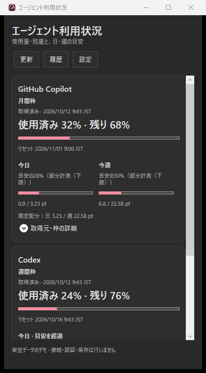

# Agent Usage Monitor

Windowsのトレイから、GitHub Copilot・Codex・Claude Codeなどコーディングエージェントの契約枠の使用量と
日/週の固定目安を確認する軽量アプリです。VS Code、ブラウザー常駐、Electron、WebView、
WSL、独自クラウドバックエンドを必要としません。



画像は架空データです。実アカウントのUsage・認証・ローカルパスは含みません。
[ライト表示](docs/images/usage-demo-light.png)。

**0.2.1は常駐終了経路の修正・診断追加版です。** 配布物は未署名です。
[変更内容と検証の限界](docs/release-notes-0.2.1.md)を確認してください。

## できること

- サービス/アカウント/枠を合算せず、使用率・残量・取得時刻・resetを表示。
- Copilot月枠÷実際の日数を日目安、日×7を週目安に固定配分。
- Codex/Claudeの週間枠が得られる場合は枠÷7を日目安にする。
- 使用率の刻み、80/90/95%等のしきい値、日/週目安超過、確認済みresetを通知。
- 通知と観測差分を保存し、再起動後の同一通知の連発を抑止。
- ダーク/ライト、枠ごとの通知設定、本人が選ぶログオン時起動。
- 日本語/English。Windows表示言語に合わせるか、設定で明示選択して保存。
- JSTの日別履歴、7/30/90日・任意月の棒グラフ、period別表示と部分計測。
- 履歴保存先の選択、月別ローテーション、検証付きZIP、保存フォルダー/ファイルを開く導線。
- タスクバー上の軽量native小型表示。Copilot月間、Codex/Claude週間の契約使用率を表示。
- インストーラー版のアプリ内更新確認、ポータブル版の公式Release案内。

## 使い始める

Windows 11 x64、利用するproviderの契約と公式CLIの本人認証が必要です。
Releaseのinstallerとportable ZIPは.NET 10 Windows Desktop Runtime同梱です。
ソースから開発する場合は.NET 10 SDKが必要です。

### インストーラー（公開後の推奨）

1. [公式Releases](https://github.com/aktsmm/agent-usage-monitor/releases)から
   `AiUsageTrayDesktop-win-Setup.exe` と `SHA256SUMS.txt` を取得。
2. SHA256を確認してinstallerを実行。
3. スタートメニューの **Agent Usage Monitor** を開く。初回は現在の公式CLIログインを確認し、
   照合できたCopilot/Codexを自動設定して取得を開始。結果は **設定 → 接続**で確認。
4. 常駐する場合はトレイの **ログオン時に常駐** または **外観・起動**設定で選択。

installerは現在のユーザーの `%LOCALAPPDATA%\AiUsageTrayDesktop` に配置します。
スタートメニューのショートカットを作成しますが、自動起動は勝手に有効にしません。
0.1.1から表示名はAgent Usage Monitor、パネル見出しは「エージェント利用状況」です。
既存版の更新互換性のため、内部packId、EXE・配布資産名、データ/インストール先、
ログオン起動の登録名はAiUsageTrayのまま維持します。0.1.0の更新先は旧URLのままなので、
新canonical URLを使うのは0.1.1への安全な更新後です。

### ポータブル ZIP

`AiUsageTrayDesktop-win-Portable.zip` を安定した書き込み可能フォルダーへ展開し、
`AiUsageTray.Desktop.exe` を実行してください。ZIP内部のruntime一式を保持してください。
ポータブルでもデータはアプリのフォルダーでなく `%LOCALAPPDATA%\AiUsageTray` に保存します。
自己上書き更新はせず、新ZIPまたは公式installerへ案内します。

```powershell
Get-FileHash -LiteralPath '.\AiUsageTrayDesktop-win-Setup.exe' -Algorithm SHA256
```

`SHA256SUMS.txt` はinstaller/ZIP/更新package/feed等の全資産のhashを記載します。
hashは整合性を確認するもので、署名の代替ではありません。現候補は未署名のため
SmartScreen等で警告される場合があります。Defender除外や保護機能停止は推奨しません。

## トレイと更新

左クリックで利用状況、右クリックで **Usageを更新 / 設定 / アプリの更新を確認 /
ログオン時に常駐 / 終了**。画面を閉じてもUsage取得と通知は続きます。
アプリを止める場合は **終了** を選びます。

以下の終了診断・修正は0.2.1で追加しました。配布済み0.2.0には含まれません。
常駐本体には経過時間だけで終了するタイマーはありません。小型表示への `WM_CLOSE` は
本体の終了操作として扱わず、ウィンドウと次回更新を維持します。
常駐の終了調査用に、プロファイル内の `diagnostics` にローカル証跡を保存します。
`host.jsonl` と `host.jsonl.previous` は各128 KiB以内、`host-run.json` は直近の起動・1分ごとの
メッセージループ応答・終了状態です。起動ID、PID、版、終了理由、処理段階、
例外型とアプリ内のメソッド名だけを記録し、例外メッセージ・ソースパス・アカウント・
Usage・token・provider応答は記録しません。外部送信や自動再起動はありません。
`CleanExit` は保存・後処理とメッセージループの終了を確認した場合だけ記録します。
記録がない停止は正常終了とせず、次回起動で `PreviousRunIncomplete` を残します。
これは強制終了・クラッシュ・電源断を区別する証拠ではなく、「正常終了を確認できない」
という意味です。1分ごとの記録はUsage取得成功の証明でもありません。
予期しないコールバック例外は証跡とエラー表示を残して異常終了し、無条件に握り潰して
常駐を続けません。更新helperはこの異常終了を正常な更新準備と解釈しません。

**小型表示は初期ON**です。小型表示またはトレイの右クリック、設定の **外観・言語**から
表示/非表示を切り替えます。本人がOFFにした選択は更新・再起動後も保持します。
ドラッグで位置調整し、ダブルクリックで利用状況を開きます。標準タスクバーを書き換えません。
複数枠が曖昧な場合や未取得は「—」、古い値はその旨を表示し、日目安の消化率とは混ぜません。

表示言語は **システムに合わせる / 日本語 / English**。ja系のWindows表示言語では日本語、
それ以外はEnglishを選びます。言語を変えてもJST日境界・月曜開始・記録ID・通知抑止は変わりません。

インストーラー版は **起動時の自動更新が初期状態から有効**です。
**外観・起動・更新**で無効にできます。ログオン時起動とは独立した設定です。
GitHubの `aktsmm/agent-usage-monitor` の安定Releaseのみを使用し、tokenは送信しません。
新しい版をダウンロードしてmanifestのバージョン・package ID・サイズ・SHA256を検証します。
**画面を開いている間と接続確認中は適用を延期**し、未保存の変更を勝手に閉じたり破棄しません。
画面を閉じた後に、取得を停止・所有する子を終了・履歴を保存・leaseを解放してから更新し、
トレイで再起動します。待機中に更新helperを常駐させません。
同じ版の再適用・downgrade・draft・pre-releaseは拒否します。
手動の **アプリの更新を確認**も保持します。portable版は自己上書きしません。
今はPrivateかつ安定Release未公開のため、認証なしの404は「公開済みの安定版を確認できない」です。
起動ごとにエラーダイアログを出さず、設定画面に状態を表示します。
ネットワーク/更新失敗は表示し、Usageや設定をゼロ/初期値へ戻しません。
既存の「起動時は自動確認、適用は都度本人確認」という方式とは意図的に異なり、
今回の設定は安全なタイミングでの自動適用まで含みます。Velopack自身の無条件startup auto-applyは無効のままです。

## 接続と非公開APIの注意

新規プロファイルの初回だけ、公式CLIの現在の選択を検出します。唯一の選択アカウントと
APIが返した利用可能な枠を照合できたCopilot/Codexは、名前・パス入力なしで取得を開始します。
tokenはコピー保存せず、認証元・identityの固定ハッシュ・必要なパスと検出状態だけを保存します。
plan名から分母・token・creditsを推定しません。

| サービス | 認証と取得 | 制限 |
| --- | --- | --- |
| Copilot | `gh auth status --active --hostname github.com --json hosts`の選択1件だけ。同じtokenで`/user`のloginとIDを照合・固定しUsage-only GET | `copilot_internal/user`は非公開API。ghがなくCopilot CLIだけの場合、正確な選択credentialのWindowsターゲットを文書から確定できないので自動接続未対応。詳細設定の指定1件は保持 |
| Codex | `CODEX_HOME`または既定`~\.codex`の`auth.json`。ChatGPTのメールmetadataと選択account_idを固定しUsage-only GET | `wham/usage`は非公開API。`keyring/auto/ephemeral`等の別認証元は自動接続未対応。公式`account/read`はaccount_idを返さないためメールだけで代用しない |
| Claude Code | CLIの存在・version・公式`claude auth status`を確認し、本人準備のstatusline scalar snapshotを利用 | 未ログインは「ログインが必要」。snapshotを現在account/configへ確実に結び付けられないため自動有効化しない。独自OAuth・Cookie・推論なし |

GitHubログイン/ID・Codexメール/account_idが一致しなければ止め、以前のUsageも非表示にします。
次回起動でアカウントを勝手に切り替えません。無差別なcredential探索、
VS Code secret storage、browser Cookie、独自login/token保存/refresh、ダミー推論はありません。
JWTのdecodeはローカル選択metadataを読む処理であり、署名検証ではありません。
providerの契約、企業SSO/ポリシー、各サービスの規約を確認してください。

Codexの限定fallbackを有効化すると、公式 `codex app-server` で
`initialize / initialized / account/read(refreshToken:false) / account/rateLimits/read` のみ実行します。
推論やcredit消費は呼びません。CLIは取得時だけ起動し期限・終了を管理します。
**fallbackも同じbackendを使うためサービス障害には効きません。**
初回自動設定では、PATHの絶対ディレクトリにある`codex.exe`、または公式npm packageの
Windows x64ネイティブEXEを確認できた場合だけfallbackを既定で有効にします。
相対PATH・現在の作業ディレクトリ・任意shell shimは実行しません。
実行ファイルがなくても直接HTTPで確認できれば自動設定できます。保存済みの手動fallback選択は維持します。

### 初回・旧版移行・再検出

接続設定schema v1はサービスごとに未試行・自動設定・手動・本人無効・試行済み・確認待ちを区別します。
検出開始前に試行済みを保存し、失敗・中断後の再起動でCLI試行やlogin promptを繰り返しません。
timeout・cancel・ネットワーク・認証・スキーマ・曖昧な選択は別の状態です。
既存の通知・履歴・テーマ・ログオン時起動・手動のaccount/pathは維持します。

0.1.0は「初期値disabled」と「本人disabled」の区別を保存していません。
既存のaccount/path指定があるサービスは手動設定として保持し、未設定の意図が不明なサービスだけ
**自動設定する／未設定のまま使う**を一度確認します。見送った選択も保存します。
旧版の最後の確認済みaccountは移行時に固定し、未知の場合は指定identityに一致した最初の取得で固定します。

**再検出**は現在の候補を確認するだけです。保存済み設定・手動設定・無効化を上書きしません。
候補への変更は本人が **確認した候補を使用 → 変更を保存**を選んだときだけです。
手入力は詳細設定にまとめています。Claudeのstatusline変更には別途差分確認と明示承認が必要です。

5分ポーリング、20秒取得期限、連続失敗backoff、429 Retry-Afterを尊重します。
401・403・ネットワーク・スキーマ変更を区別し、古い最終確認値は日時とともに表示します。
非公開APIの変更・分母/reset欠落時に数値を捏造しません。

### Claude statusline

CLIの公式loginは利用者が行います。既存statuslineをアプリが自動で上書きすることはありません。
`AiUsageTray.Diagnostics.exe claude-export <ラベル> <JSONパス>` は公式statusline JSONのstdinから
`five_hour`/`seven_day`の`used_percentage`・`resets_at`だけを保存します。
会話、transcriptパス、session/tokenは保存しません。

既存statuslineと同じstdinをexporterへ渡す連携は、設定差分を確認してから行ってください。
最初のAPI応答後だけ更新されるため停止中のライブ値ではなく、古いsnapshotは新通知に使いません。
statuslineに確実なaccount identityがないため、利用者が公式CLIで確認したラベルを指定し、
アカウントを変えた場合はラベルも変えてください。
Claude.ai資格情報を集める直接OAuth取得は実装していません。Admin/API費用は契約ライブ枠の代替ではありません。

## 目安と未計測

目安は利用を止める制限ではなく、固定の消費ペースです。繰越・残量再配分はありません。
使用率だけなら同一quota内のpercentage-point（pt）を使い、token/金額を作りません。
日境界はJST、暦週は月曜開始。provider resetをまたぐ週は枠のperiodごとに分けます。

初回起動前や未観測の境界をまたいだ使用量は **未計測/部分計測** です。
0差分はproviderの累積観測値の差が0だっただけで、丸めがあるAPIの厳密な無消費を証明しません。
減少/top-up相当とreset/plan変更は消費と分けます。
通知候補は表示前に保存するat-most-once方式で、直後のcrashやWindows集中モードにより
配送されない可能性があります。Windows通知の配送は保証しません。

## データとアンインストール

設定・Usage差分・通知履歴は `%LOCALAPPDATA%\AiUsageTray` に保存します。
失敗は90日保持し、現行periodの通知抑止キーを保持します。
唯一のraw差分は保存/検証済みarchiveがないまま90日で削除しません。
日別履歴は **履歴**、保存先・ZIP・保存場所の操作は **履歴・保存設定**から開きます。
保存先変更はプレビュー→本人確認→copy→hash/content検証→切替の順で、元データを残します。
[保存方式・移行手順・制限](docs/history-storage.md) /
[履歴と保存設定の架空UIモック](docs/ui/history-storage-mock.html)。
設定には本人のアカウント名/メール/パスを含むため、共有する際は除去してください。

Windowsのアプリ設定からアンインストールすると、installer管理の本体/ショートカットと、
そのinstall配下を指すアプリ自身のRun登録を除去します。Usage履歴・公式CLI認証は消しません。
portableを移動/削除する場合は先にログオン時起動を無効にしてください。
[プライバシー](PRIVACY.md) / [セキュリティ](SECURITY.md) / [第三者NOTICE](THIRD-PARTY-NOTICES.txt)。

## 軽量性

常駐本体はWindows標準トレイ/メッセージループと直接HTTP、WPF画面は表示時だけの子プロセスです。
画面を閉じると子を終了します。IPCはcurrent-user-only named pipeと起動したPID照合。
Windows NLSを使用し、不要なICU/WinForms/WPF描画の常駐を避けます。

初版の短時間検証では、表示/終了を3回繰り返して終了30秒後の本体＋全生存子孫の
Working Setは約70〜74MiB、表示中は合算約214〜224MiBでした。
最終runtime同梱候補は画面終了30秒後約93MiB、追加60秒後も約93MiB（子0）、
表示中約256MiBでした。**常駐と表示ピークは別**です。
0.1.1の自動接続候補は専用profileで表示3回を行い、終了30秒後約77.55～78.03MiB、
追加60秒後約77.99MiB（子0）、表示中約227～233MiBでした。
0.2.0のruntime同梱版は、合成データ・全provider無効・小型表示ONの専用profileで、
起動30/60/90秒後のWorking Set約49.44～49.47MiB、子0を確認しました。
実アカウント取得中の値・画面表示ピーク・長期運用はこの合成条件の値とは別です。
runtime同梱配布の容量、長期運用、別PC、更新/CLI取得ピークは別に検証します。
強制trim/GCやPrivate Bytesへの指標差し替えは行いません。

## 開発と公開準備

```powershell
dotnet build .\AiUsageTray.slnx -c Release
dotnet run --project .\tests\AiUsageTray.Tests -c Release
dotnet run --project .\src\AiUsageTray.Desktop -c Release
.\scripts\package.ps1
```

テストはConsole runnerです。`dotnet test`だけではこのテスト群を実行できません。
[配布手順と公開ゲート](docs/distribution.md) / [設計](docs/implementation-handoff.md)。
UI参考: [ダーク](docs/ui/usage-tray-dark.html) / [ライト](docs/ui/usage-tray-light.html)（架空値）。
`AiUsageTray.Desktop.exe --demo`（または`--demo --light`）は公開画像作成用の
架空データ表示です。認証・接続・保存・常駐は行いません。
## ライセンス

本プロジェクトが作成したソースコード、アプリbinary、スクリプト、テスト、文書と画像は
[CC BY-NC-SA 4.0＋Microsoft Corporationおよび関連会社への追加許諾](LICENSE)です。
Microsoft向けはNonCommercial制限だけを免除し、Attribution・ShareAlike・no-additional-restrictionsは維持します。
他の利用者には標準の非商用条件が適用されます。第三者依存・商標・取得したサービスデータはこの許諾の対象外です。

非商用制限があるためOSI定義のオープンソースではなく、**ソース公開アプリ**として提供します。
Creative Commonsは一般にソフトウェアへのCCライセンス適用を推奨していません。
このライセンスはソース提供を義務付けるソフトウェア専用の条項を持たず、特許権・商標権も許諾しません。
それらの限界を踏まえたオーナーの選択です。依存の元ライセンスは保持します。

## 公式資料

- [Codex App Server](https://developers.openai.com/codex/app-server)
- [Codex認証とcredential storage](https://developers.openai.com/codex/auth)
- [GitHub CLI active認証](https://cli.github.com/manual/gh_auth_status)
- [GitHub CLI tokenの選択規則](https://cli.github.com/manual/gh_auth_token)
- [Copilot CLI認証](https://docs.github.com/en/copilot/how-tos/copilot-cli/set-up-copilot-cli/authenticate-copilot-cli)
- [Claude CLI auth status](https://code.claude.com/docs/en/cli-reference)
- [Claude statusline](https://code.claude.com/docs/en/statusline#rate-limit-usage)
- [Claude認証規定](https://code.claude.com/docs/en/legal-and-compliance#authentication-and-credential-use)
- [Windows .NET導入](https://learn.microsoft.com/ja-jp/dotnet/core/install/windows)
- [Windows NLS/ICU](https://learn.microsoft.com/ja-jp/dotnet/core/extensions/globalization-icu)
- [Velopackの統合](https://docs.velopack.io/integrating/overview)
- [Windowsアイコンのownership](https://learn.microsoft.com/ja-jp/windows/win32/menurc/about-icons)
